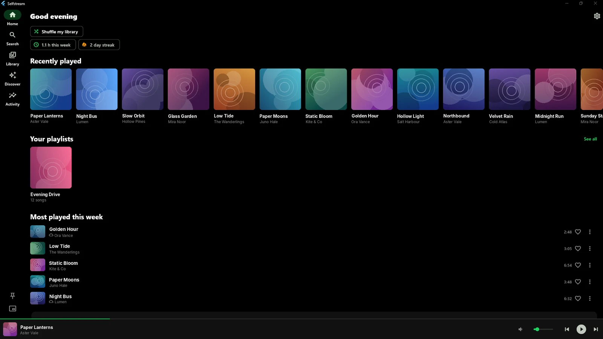
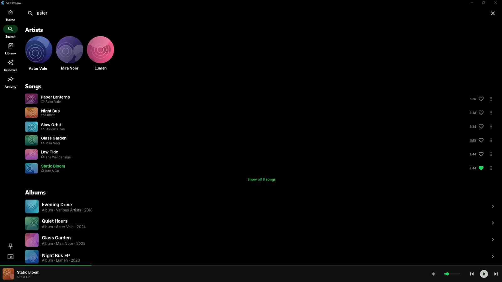
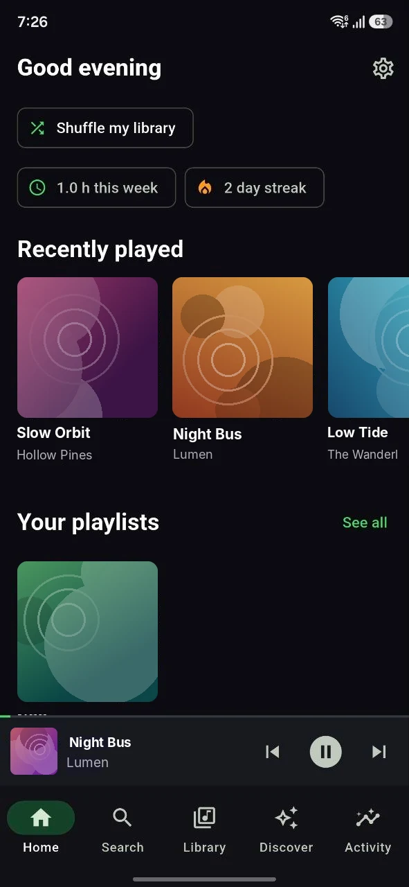
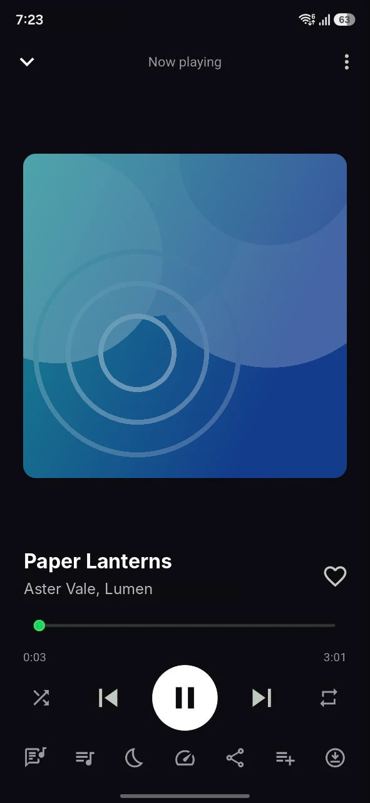
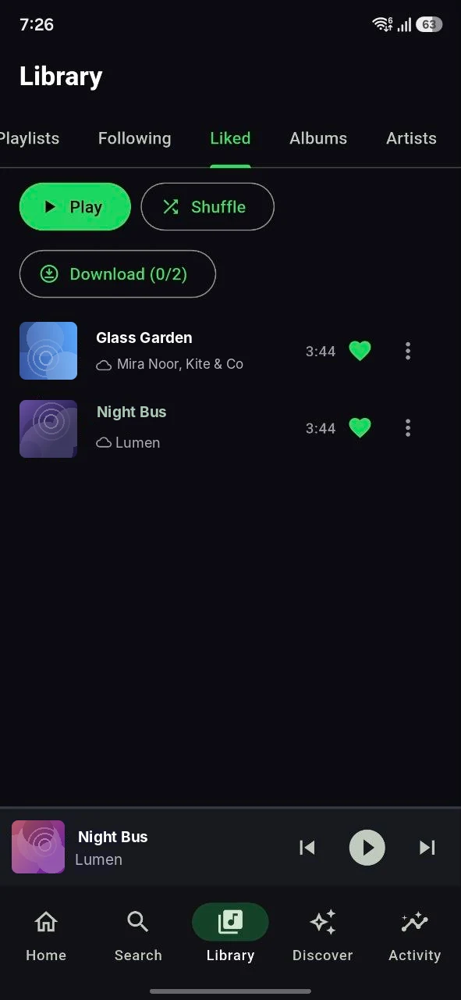
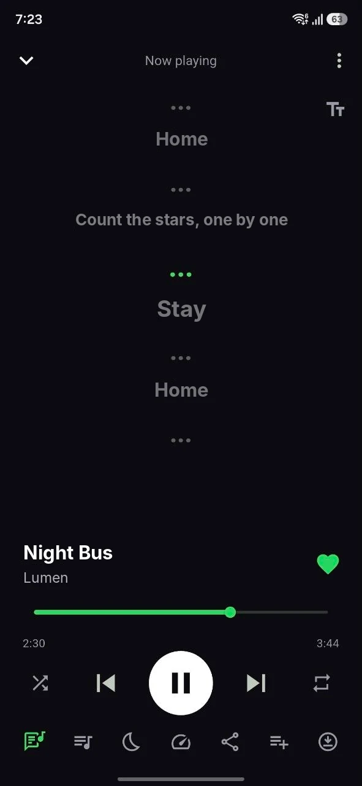
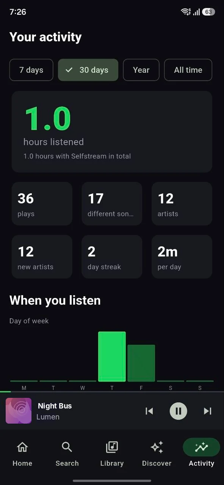

# Selfstream

A music player app for your own music server. It connects to any **Subsonic / OpenSubsonic** server
(Navidrome, Gonic, Airsonic and others) and, if the server offers the optional **Selfstream extension**, it
shows the extra tabs, screens and features that the server describes.

- **Windows** app (installer), built from a Flutter code base
- Synced lyrics, queue, sleep timer, themes, offline copies of songs
- Offline view: the last pages you opened are saved, and songs saved on the device still play
- Windows: volume slider, mini player (with lyrics), keep-on-top, optional Discord "now playing" card
- Home, Discover and Activity are **drawn from data the server sends**, so a server can add or change tabs and
  screens without a new app release

The app contains no music and no music sources. What you can play depends entirely on the server you sign in to.

## Screenshots




<p>
    
</p>

## Before you start

Selfstream is a client for a server **you run yourself** (Navidrome plus the
[selfstream server](https://github.com/TaiDies/selfstream-server)). There is no hosted service and no account with us.

1. Install the server (one command on Proxmox, or Docker on x86).
2. Install the app and sign in with your Navidrome username and password.

Please read this: you are responsible for the server you run and for the music you put on it. YouTube search and
download use yt-dlp, which can break without notice when YouTube changes, and may be restricted by YouTube's terms or
the law where you live. Only download what you have the right to. The software is provided as is, without warranty.
If something breaks, Settings has a "Copy diagnostic info" button to paste into a bug report.

## Install

Download the latest build from the **Releases** page:

| Platform | File |
|---|---|
| Windows | `selfstream-setup.exe` (installer, no admin rights needed; the app checks GitHub for a newer build when it starts and offers to update). `selfstream-windows.zip` is a portable copy without updates |

Open the app, enter your server address (for example `http://192.168.1.50:4533`) and your login.

## Servers

| Server | What you get |
|---|---|
| Any Subsonic / OpenSubsonic server | Home (album lists), Search, Library (Liked, Albums, Artists, offline songs), player, lyrics |
| A server that also implements the Selfstream extension | Everything above plus whatever it advertises: playlists, follows, Discover, Activity, search suggestions, listening history, queue sync across devices |

How the app talks to a server, and how to build one that offers the extension, is in
**[docs/SERVER.md](docs/SERVER.md)**.

## Building from source

You need Flutter 3.35 (stable). The platform folders are not committed; they are generated:

```bash
flutter create --platforms windows .
flutter pub get
flutter analyze
flutter test
flutter build windows --release
```

## Code layout

```
lib/core    server API client and data classes (no Flutter imports, reusable on every platform)
lib/state   session, library, player, offline store, settings, desktop window, Discord presence
lib/ui      screens and widgets, including the renderer for server-described screens (server_screen.dart)
lib/platform  small platform helpers (Discord IPC for Windows)
```

## Licenses

Check the licenses of the packages in `pubspec.yaml` (notably the Windows audio libraries from `media_kit`)
before you distribute or sell builds. This repository does not yet include a license of its own.
